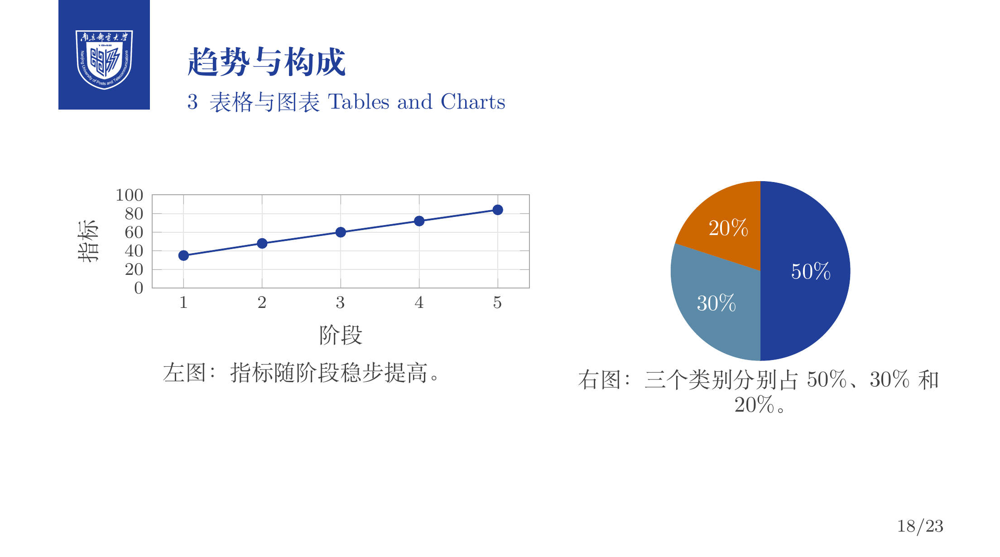

<p align="center">
  
</p>


<h1 align="center">NJUPT Beamer Template</h1>


<p align="center">
  <a href="README.en.md">English</a> · <a href="template/demo.pdf">查看示例 PDF</a> · <a href="#快速开始">快速开始</a> · <a href="#项目级-skills">项目级 Skills</a>
</p>

南京邮电大学风格的 LaTeX Beamer 演示文稿模板。共享主题和示例位于 `template/`，每份演示文稿可在 `project/` 下拥有独立的源码和资源。

## 特性

- NJUPT 校徽、首页横幅与背景，以及标题页、章节页和结束页。
- 支持中文和英文内容；可调整普通页面的字号和行距。
- 演示文稿通过相对路径加载共享主题，无需复制主题和校徽。
- 提供 VS Code / LaTeX Workshop 配置与项目级 Codex Skills。

<p align="center">
  
  
  
</p>

## 环境要求

安装 LaTeX 发行版、`latexmk` 和 XeLaTeX。中文模式还需要相应的中文字体：Linux 使用 Noto Serif CJK SC，Windows 使用 SimSun，macOS 使用 Songti SC。

## 快速开始

### 1. 编译示例

```bash
cd template
latexmk -xelatex demo.tex
```

也可以直接查看 [demo.pdf](template/demo.pdf)。

### 2. 创建演示文稿

在 `project/` 下为每份演示文稿创建独立文件夹，例如：

```bash
mkdir -p project/proj1
```

创建 `project/proj1/slide.tex`：

```tex
\documentclass{beamer}
\usepackage[njupt, zh]{../../template/collegebeamer}

\title{南京邮电大学 Beamer 演示}
\subtitle{演示文稿}
\author{Your Name}
\date{\today}

\begin{document}
\maketitle

\section{介绍}

\begin{frame}{示例页面}
  这是第一张幻灯片。
\end{frame}

\QApage{}
\end{document}
```

默认主题为 NJUPT；使用 `bnu` 选项可切换到北京师范大学主题，`polyu` 选项可切换到香港理工大学主题。主题从 `template/assets/` 加载资源。若源文件位于更深的目录，请相应调整 `\usepackage` 的相对路径。

### 3. 编译与清理

在演示文稿目录中编译中文幻灯片：

```bash
cd project/proj1
latexmk -xelatex slide.tex
```

也可在 VS Code 中打开仓库根目录，安装推荐的 LaTeX Workshop 扩展，使用 **XeLaTeX (latexmk)** 配方。输出文件位于源文件目录。

从仓库根目录清理指定源文件的中间产物，保留 PDF 和 SyncTeX：

```bash
./.vscode/clean-linux.sh project/proj1/slide.tex
```

## 表格与图表

主题提供 `NJUPTtable` 环境和 `\NJUPTtoprule`、`\NJUPTmidrule`、`\NJUPTbottomrule`，用于带分组线的双线表头和表底；支持 `tabularx`、`\multirow` 和 `\cline`。图表使用 PGFPlots，`njupt chart` 样式提供主题配色和网格。完整的表格、单项与多项折线图、折线与饼图组合及柱状图示例见 [demo.tex](template/demo.tex)。图表数据写在 TeX 源文件中，生成的是静态 PDF 图形。

## 页面缩放

在导言区设置普通页面的字号和行距，例如：

```tex
\setbeamerzoom{0.8}
```

默认值为 `1`，参数必须为正数。普通页面内的字号命令和区块文字也会按比例缩放；标题页、章节与小节页、`\QApage` 和 `\bibliographpage` 不受影响。固定尺寸的图片、边距和间距不会自动缩放。

自定义特殊页面可以在局部组中保持原字号：

```tex
{\collegebeamerSpecialFrame
\begin{frame}{特殊页面}
  页面内容
\end{frame}
}
```

## 项目级 Skills

在 Codex 中使用项目文件夹名称作为标识：

| Skill | 用途 | 示例 |
| --- | --- | --- |
| [create-new-slide](.agents/skills/create-new-slide/SKILL.md) | 创建并聚焦演示文稿项目 | `$create-new-slide proj2` |
| [focus-slide](.agents/skills/focus-slide/SKILL.md) | 定位并聚焦已有项目 | `$focus-slide proj1` |

## 目录结构

```text
.
├── template/                  # 共享主题、资源和示例
│   ├── collegebeamer.sty
│   ├── demo.tex
│   └── assets/
├── project/                   # 在此为每份演示文稿创建独立文件夹
├── .agents/skills/            # 项目级 Codex Skills
├── .vscode/                   # LaTeX Workshop 配置和清理脚本
└── assets/                    # README 图片
```

`project/` 内的项目内容由 Git 忽略，`.gitkeep` 用于保留目录。

## 致谢

本主题基于以下项目开发：

- [SINTEF Presentation](https://www.overleaf.com/latex/templates/sintef-presentation/jhbhdffczpnx)
- [college-beamer](https://github.com/liu-qilong/college-beamer)

## 许可

详见 [LICENSE.md](LICENSE.md)。
