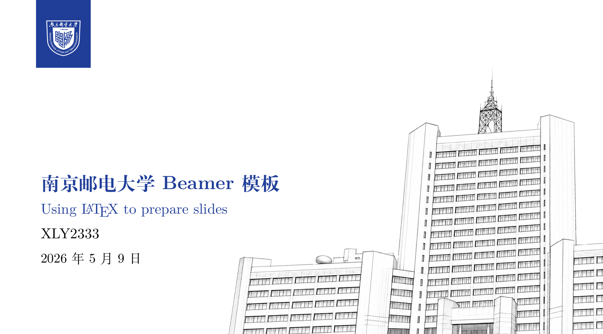
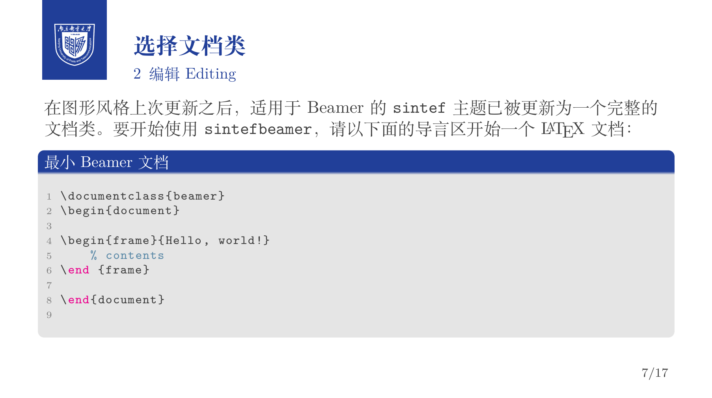

# 南京邮电大学 Beamer 模板

你好 👋 这是一个基于 [SINTEF Presentation](https://www.overleaf.com/latex/templates/sintef-presentation/jhbhdffczpnx) 模板和 [college-beamer](https://github.com/liu-qilong/college-beamer) 进行二次开发的 Beamer 模板。感谢 [Federico Zenith](mailto:federico.zenith@sintef.no) 设计了这样优秀的作品，感谢 [Qilong Liu](https://github.com/liu-qilong) 同学的修改。

本项目在保留原作者信息的前提下，对原模板进行了适配与修改，用于南京邮电大学相关场景的演示文稿制作。





查看全量PDF文档 [Here](./demo.pdf)

---

## 功能简介

本模板适用于南京邮电大学风格的 Beamer 演示文稿制作，支持以下基本功能：

- 南京邮电大学主题样式
- 中英文语言切换
- 目录页
- 分节页
- 数学公式排版
- 代码高亮显示
- 结束页 / 致谢页

---

## 使用方法

### 1. 加载宏包

在导言区加载 `collegeBeamer` 宏包，并指定学校与语言选项。例如：

```tex
\usepackage[njupt, zh]{collegeBeamer}
```

其中：

- `njupt` 表示南京邮电大学主题
- `zh` 表示中文模式

如果使用英文模式，可以写为：

```tex
\usepackage[njupt, en]{collegeBeamer}
```

---

### 2. 语言选择

模板支持以下语言选项：

- `en`：英文
- `zh`：中文

示例：

```tex
\usepackage[njupt,en]{collegeBeamer} % 英文
```

或

```tex
\usepackage[njupt,zh]{collegeBeamer} % 中文
```

注意：

- 若选择 `zh`（中文），请使用 **XeLaTeX** 编译，以确保中文字体正常显示。
- 若选择 `en`（英文），通常可使用 **pdfLaTeX** 编译。

---

### 3. 标题信息设置

你可以像普通 Beamer 一样设置标题页信息，例如：

```tex
\title{南京邮电大学 Beamer 模板}
\subtitle{Using \LaTeX\ to prepare slides}
\author{Your Name}
\date{2026年5月9日}
```

然后在正文中使用：

```tex
\maketitle
```

来生成标题页。

---

### 4. 基本示例

一个最简单的示例如下：

```tex
\documentclass{beamer}
\usepackage[njupt, zh]{collegeBeamer}

\title{南京邮电大学 Beamer 模板}
\subtitle{Using \LaTeX\ to prepare slides}
\author{Your Name}
\date{\today}

\begin{document}

\maketitle

\begin{frame}{示例页面}
    这是一个简单的 Beamer 幻灯片示例。
\end{frame}

\end{document}
```

---

## 常用说明

### 分步显示项目符号

在 Beamer 中，可以使用 `<+->` 实现项目逐步显示，例如：

```tex
\begin{itemize}[<+->]
    \item 第一项
    \item 第二项
    \item 第三项
\end{itemize}
```

放映时会按顺序逐项出现。

---

### 插入图片

插入图片的方式与普通 `\LaTeX` 相同，例如：

```tex
\includegraphics[width=\textwidth]{example-image}
```

---

### 代码环境

如果模板已配置代码高亮环境，可以直接使用 `lstlisting`：

```tex
\begin{lstlisting}[language=TeX]
\begin{frame}{Hello}
    content
\end{frame}
\end{lstlisting}
```

---

## 二次开发说明

如果你希望在本模板基础上继续修改，例如调整校徽、背景图、主色调、标题页样式等，请注意：

- 保留 [SINTEF Presentation](https://www.overleaf.com/latex/templates/sintef-presentation/jhbhdffczpnx) 原作者信息与原始来源链接
- 保留许可协议说明
- 明确标注你的修改内容
- 不要移除原始版权声明

建议在 README 或项目说明中注明：

- 原项目名称
- 原作者
- 原项目链接
- 你所做的修改内容

---

## 反馈与建议

如果你在使用过程中发现问题，或有改进建议，欢迎提交 issue 或提出修改意见。

---

## 致谢

- 原始模板作者： [Federico Zenith](mailto:federico.zenith@sintef.no)
- 原始模板项目： [SINTEF Presentation](https://www.overleaf.com/latex/templates/sintef-presentation/jhbhdffczpnx)

感谢原作者提供优秀的设计基础。
